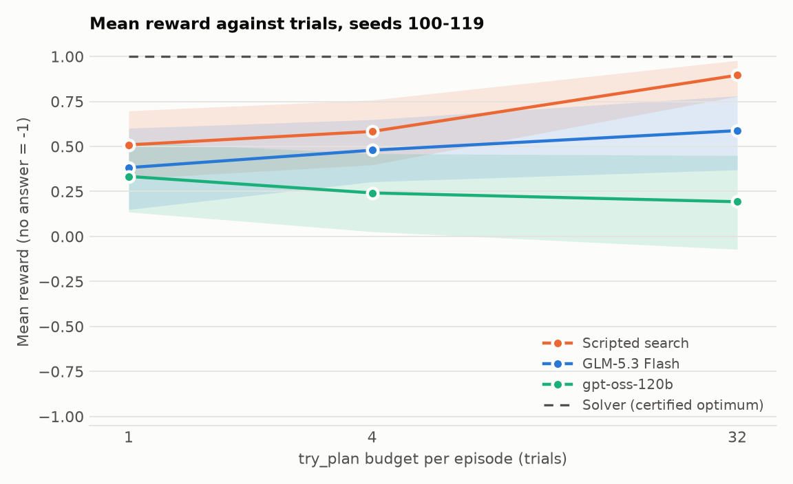

# Gap evaluation, environment v3: two small models as section controllers, before any training (25 October 2026)

This is the current report. It follows an earlier run on environment v2 and adds `policy` as a required field, reruns GLM-5.3 Flash, and adds gpt-oss-120b. Use these numbers, not the v2 ones.

**Question.** How far are small, cheap models from the certified optimum on this environment, and where do they fall short?
**Models tested.** `glm-5p3-flash` and `gpt-oss-120b` on Fireworks, both at low reasoning effort. Neither is a frontier model, so this describes small models at this setting. Qwen3.8 27B was considered but is not served serverless on this account.
**Data.** `heldout_v1`, no tuning against it. Environment `dispatch_env_v3_policy_required`, prompt `prompt_v2_brief`, recorded in every result file.
**Spend.** About $4.73 estimated for 2,080 evaluation episodes (GLM-5.3 Flash $3.05, gpt-oss-120b $1.68). Smoke tests and earlier rounds were extra, about $3.5 in total.

## Conclusion

1. **Is there a clear gap to the solver at 1-4 trials? Yes, for both models.** Mean reward (no answer counts as -1) is 0.30 and 0.42 for GLM-5.3 Flash at 1 and 4 trials, and 0.18 and 0.23 for gpt-oss-120b, against 1.0 for the solver. They reach the certified optimum in 21% and 29% (GLM) and 18% and 21% (gpt-oss) of episodes.
2. **Do they beat the scripted search at the same budget? No, with one near-tie.** Per seed, GLM-5.3 Flash minus scripted search is -0.08 (95% CI -0.13 to -0.04) at 1 trial, **-0.07 (-0.15 to +0.01) at 4 trials**, and -0.31 (-0.51 to -0.13) at 32. The 4-trial interval just includes zero, and GLM wins more episodes than it loses there (69 against 54). gpt-oss-120b is clearly below the scripted search at every budget: -0.20, -0.26 and -0.70. At 1 trial the scripted search is simply the default plan.
3. **Is the gap decision skill, or still harness and format? Part of the earlier gap was the interface; most of what remains is decision skill.** Making `policy` required removed it entirely: both models supplied it in every action and there were no rejections. For GLM, the same-model reruns improved from 0.26 to 0.30 (1 trial), 0.33 to 0.42 (4) and 0.55 to 0.59 (32, seeds 100-119), and the gap to the scripted search shrank from -0.13, -0.16, -0.35 to -0.08, -0.07, -0.31. What is left is quality and discipline, not format: no-answer is at most 1% for either model, and two models with identical format compliance differ a lot, so the format cannot explain the rest. The remaining weaknesses are in the failure labels below. At 1 trial, 52% of GLM episodes and 42% of gpt-oss episodes submit without trying anything. Holds are never used in 94% (GLM) and 76% (gpt-oss) of 1-trial episodes. At 32 trials GLM repeats itself in 82% of episodes and gpt-oss stops after about 8 of its 32 trials. Caveat: both ran at low reasoning effort (about 230 output tokens per episode for GLM at 1 trial and 1,400 at 4), which was needed to avoid running out of output, so this is not their ceiling.
4. **Does best-of-8 suggest RL has something to sharpen? Yes, but less than the v2 run suggested.** Best of 8 one-trial samples against the mean of the same samples: 0.55 against 0.35 for GLM, 0.51 against 0.29 for gpt-oss. That spread of about 0.2 is what training could move. But on the 36 seeds with headroom, a sample beats the default on only 9 (GLM) and 5 (gpt-oss), and is optimal on 2 and 1; in v2 these were 16 and 7 for GLM. Part of the v2 spread came from calls that omitted `policy` and so started from the other base ordering, which added diversity by accident. The caveats are the same as before: the best sample is picked with hindsight, and it is two cheap models on 50 seeds.

## Chart



Mean reward against trial budget on seeds 100-119, so all three budgets use the same problems (the 32-trial runs cover only those 20 seeds). Bands are 95% bootstrap intervals over seeds. The 1-trial scripted search is the default plan. Full-sample numbers (100 seeds at 1 and 4 trials) are in the tables.

## What changed from v2 for GLM-5.3 Flash

Same model, same seeds, after `policy` became required. Mean reward, all 100 seeds at 1 and 4 trials and seeds 100-119 at 32:

| Trials | v2 reward | v3 reward | v2 gap to scripted search (95% CI) | v3 gap to scripted search (95% CI) |
| ---: | ---: | ---: | ---: | ---: |
| 1 | 0.26 | 0.30 | -0.13 (-0.19 to -0.06) | -0.08 (-0.13 to -0.04) |
| 4 | 0.33 | 0.42 | -0.16 (-0.24 to -0.07) | -0.07 (-0.15 to +0.01) |
| 32 | 0.55 | 0.59 | -0.35 (-0.57 to -0.15) | -0.31 (-0.51 to -0.13) |

The two columns come from different runs of the same model on the same seeds, and their intervals overlap at every budget. The direction is the same at all three, and the largest change is at 4 trials. Making things worse on cases that were already fine also dropped: at 4 trials GLM made the default worse on 14% of low-headroom cases (23 of 162), down from 25%, and worsened 8% of cases with headroom (11 of 138), down from 22%.

## Headline table, per model and budget

No answer counts as -1 in the headline reward. Infrastructure failures would be excluded from every rate; there were none left. Intervals are 95% bootstrap over seeds, with repeats averaged within a seed first. "vs scripted search" counts episodes where the model scored lower delay (W), equal (T), or higher or gave no answer (L) on the same seed and budget. The "seeds 110-199" rows drop seeds 100-109, which I looked at in an earlier pilot that informed two environment changes; they are within noise of the full sample.

**GLM-5.3 Flash**

| Slice | Trials | Episodes | No-answer rate (95% CI) | Mean reward, no answer = -1 (95% CI) | Mean reward, submitted only | At optimum (95% CI) | vs scripted search W / T / L | Scripted search reward (95% CI) | Tokens in / out per episode | Est. cost per episode |
| --- | ---: | ---: | ---: | ---: | ---: | ---: | ---: | ---: | ---: | ---: |
| all seeds | 1 | 300 | 0% [0, 1] | **0.30 [0.22, 0.39]** | 0.31 | 21% [14, 29] | 14 / 252 / 34 | 0.39 [0.30, 0.47] | 3,832 / 232 | $0.0007 |
| seeds 100-119 | 1 | 60 | 2% [0, 5] | **0.38 [0.15, 0.60]** | 0.41 | 27% [10, 47] | 1 / 52 / 7 | 0.51 [0.32, 0.70] | 3,886 / 278 | $0.0007 |
| seeds 110-199 (excluding 100-109) | 1 | 270 | 0% [0, 1] | **0.28 [0.19, 0.37]** | 0.28 | 20% [12, 28] | 13 / 226 / 31 | 0.36 [0.27, 0.44] | 3,811 / 225 | $0.0007 |
| all seeds | 4 | 300 | 0% [0, 0] | **0.42 [0.35, 0.50]** | 0.42 | 29% [21, 37] | 69 / 177 / 54 | 0.49 [0.41, 0.57] | 18,209 / 1,362 | $0.0034 |
| seeds 100-119 | 4 | 60 | 0% [0, 0] | **0.48 [0.30, 0.65]** | 0.48 | 35% [18, 53] | 7 / 42 / 11 | 0.58 [0.40, 0.76] | 17,276 / 1,427 | $0.0033 |
| seeds 110-199 (excluding 100-109) | 4 | 270 | 0% [0, 0] | **0.42 [0.34, 0.49]** | 0.42 | 28% [20, 36] | 65 / 158 / 47 | 0.47 [0.38, 0.56] | 18,337 / 1,337 | $0.0034 |
| all seeds | 32 | 40 | 0% [0, 0] | **0.59 [0.37, 0.78]** | 0.59 | 52% [38, 68] | 4 / 23 / 13 | 0.90 [0.78, 0.98] | 226,210 / 9,351 | $0.0386 |
| seeds 110-199 (excluding 100-109) | 32 | 20 | 0% [0, 0] | **0.50 [0.14, 0.81]** | 0.50 | 50% [25, 75] | 2 / 10 / 8 | 0.84 [0.61, 0.98] | 237,856 / 8,684 | $0.0400 |

**gpt-oss-120b**

| Slice | Trials | Episodes | No-answer rate (95% CI) | Mean reward, no answer = -1 (95% CI) | Mean reward, submitted only | At optimum (95% CI) | vs scripted search W / T / L | Scripted search reward (95% CI) | Tokens in / out per episode | Est. cost per episode |
| --- | ---: | ---: | ---: | ---: | ---: | ---: | ---: | ---: | ---: | ---: |
| all seeds | 1 | 300 | 1% [0, 2] | **0.18 [0.09, 0.28]** | 0.19 | 18% [12, 26] | 6 / 231 / 63 | 0.39 [0.30, 0.47] | 3,752 / 250 | $0.0007 |
| seeds 100-119 | 1 | 60 | 2% [0, 5] | **0.33 [0.14, 0.53]** | 0.36 | 25% [10, 43] | 0 / 52 / 8 | 0.51 [0.32, 0.70] | 3,550 / 259 | $0.0007 |
| seeds 110-199 (excluding 100-109) | 1 | 270 | 1% [0, 2] | **0.16 [0.07, 0.26]** | 0.17 | 17% [10, 25] | 6 / 206 / 58 | 0.36 [0.27, 0.44] | 3,770 / 249 | $0.0007 |
| all seeds | 4 | 300 | 0% [0, 0] | **0.23 [0.14, 0.32]** | 0.23 | 21% [14, 28] | 13 / 200 / 87 | 0.49 [0.41, 0.57] | 16,385 / 734 | $0.0029 |
| seeds 100-119 | 4 | 60 | 0% [0, 0] | **0.24 [0.03, 0.46]** | 0.24 | 28% [12, 47] | 0 / 44 / 16 | 0.58 [0.40, 0.76] | 15,684 / 775 | $0.0028 |
| seeds 110-199 (excluding 100-109) | 4 | 270 | 0% [0, 0] | **0.21 [0.12, 0.31]** | 0.21 | 20% [13, 27] | 13 / 178 / 79 | 0.47 [0.38, 0.56] | 16,621 / 731 | $0.0029 |
| all seeds | 32 | 40 | 0% [0, 0] | **0.19 [-0.07, 0.45]** | 0.19 | 28% [12, 45] | 2 / 14 / 24 | 0.90 [0.78, 0.98] | 48,821 / 1,524 | $0.0082 |
| seeds 110-199 (excluding 100-109) | 32 | 20 | 0% [0, 0] | **0.29 [-0.01, 0.59]** | 0.29 | 25% [5, 45] | 1 / 8 / 11 | 0.84 [0.61, 0.98] | 47,711 / 1,419 | $0.0080 |

Paired difference, model minus scripted search, bootstrapped over seeds (positive means the model is ahead):

- GLM-5.3 Flash, 1 trial(s): model minus scripted search = -0.08 [-0.13, -0.04]
- GLM-5.3 Flash, 4 trial(s): model minus scripted search = -0.07 [-0.15, 0.01]
- GLM-5.3 Flash, 32 trial(s): model minus scripted search = -0.31 [-0.51, -0.13]
- gpt-oss-120b, 1 trial(s): model minus scripted search = -0.20 [-0.27, -0.14]
- gpt-oss-120b, 4 trial(s): model minus scripted search = -0.26 [-0.34, -0.19]
- gpt-oss-120b, 32 trial(s): model minus scripted search = -0.70 [-0.98, -0.44]

## Where each model stands against the default plan

The model is shown the default plan's score. "Low headroom" means the optimum is the default plan or within 5% of it, where the right move is mostly to leave it alone.

**GLM-5.3 Flash**

| Run | Case type | Episodes | Better than default | Same as default | Worse than default | No answer | Mean reward |
| --- | --- | ---: | ---: | ---: | ---: | ---: | ---: |
| 1 trial(s) | headroom above 5% of optimum | 138 | 11 | 106 | 20 | 1 | -0.06 |
| 1 trial(s) | zero or low headroom | 162 | 3 | 146 | 13 | 0 | 0.61 |
| 4 trial(s) | headroom above 5% of optimum | 138 | 69 | 58 | 11 | 0 | 0.26 |
| 4 trial(s) | zero or low headroom | 162 | 19 | 120 | 23 | 0 | 0.56 |
| 32 trial(s) | headroom above 5% of optimum | 14 | 10 | 2 | 2 | 0 | 0.45 |
| 32 trial(s) | zero or low headroom | 26 | 7 | 14 | 5 | 0 | 0.66 |
| best-of-8 run (1 trial) | headroom above 5% of optimum | 152 | 16 | 116 | 19 | 1 | -0.05 |
| best-of-8 run (1 trial) | zero or low headroom | 248 | 5 | 211 | 32 | 0 | 0.59 |

**gpt-oss-120b**

| Run | Case type | Episodes | Better than default | Same as default | Worse than default | No answer | Mean reward |
| --- | --- | ---: | ---: | ---: | ---: | ---: | ---: |
| 1 trial(s) | headroom above 5% of optimum | 138 | 6 | 102 | 28 | 2 | -0.12 |
| 1 trial(s) | zero or low headroom | 162 | 0 | 129 | 32 | 1 | 0.44 |
| 4 trial(s) | headroom above 5% of optimum | 138 | 30 | 78 | 30 | 0 | -0.02 |
| 4 trial(s) | zero or low headroom | 162 | 7 | 122 | 33 | 0 | 0.44 |
| 32 trial(s) | headroom above 5% of optimum | 14 | 3 | 7 | 4 | 0 | 0.01 |
| 32 trial(s) | zero or low headroom | 26 | 3 | 14 | 9 | 0 | 0.29 |
| best-of-8 run (1 trial) | headroom above 5% of optimum | 152 | 4 | 127 | 21 | 0 | -0.07 |
| best-of-8 run (1 trial) | zero or low headroom | 248 | 2 | 203 | 43 | 0 | 0.51 |

## Best-of-8 against mean-of-8

Seeds 100-149, 8 independent samples per seed at 1 trial each. Best and mean are per seed; no answer counts as -1. For scale, the scripted search on the same seeds scores 0.46 (0.35-0.58) at 1 trial and 0.59 (0.47-0.70) at 4 trials.

**GLM-5.3 Flash**

| | Best of 8 | Mean of 8 |
| --- | ---: | ---: |
| All 50 seeds, reward (95% CI) | 0.55 [0.43, 0.66] | 0.35 [0.23, 0.47] |
| 36 seeds with headroom, reward (95% CI) | 0.38 [0.26, 0.50] | 0.15 [0.05, 0.25] |

Seeds where some sample is optimal: 16 of 50 (2 of the 36 with headroom). Seeds with headroom where some sample beats the default: 9 of 36.

**gpt-oss-120b**

| | Best of 8 | Mean of 8 |
| --- | ---: | ---: |
| All 50 seeds, reward (95% CI) | 0.51 [0.39, 0.63] | 0.29 [0.17, 0.41] |
| 36 seeds with headroom, reward (95% CI) | 0.32 [0.21, 0.44] | 0.11 [0.01, 0.22] |

Seeds where some sample is optimal: 15 of 50 (1 of the 36 with headroom). Seeds with headroom where some sample beats the default: 5 of 36.

## Failure labels

Every label that applies is counted, so rows overlap. Percentages are of eligible episodes. The last column is the best-of-8 run (1 trial, 8 samples per seed). "Never ran the default plan" means no `try_plan` with exactly the default; the default's score is stated in the observation, so a model can still compare without running it.

**GLM-5.3 Flash**

| Label | 1 trial(s) (n=300) | 4 trial(s) (n=300) | 32 trial(s) (n=40) | best-of-8 run (n=400) |
| --- | ---: | ---: | ---: | ---: |
| No valid submission (ran out of output, never submitted, or gave up) | 1 (0%) | 0 (0%) | 0 (0%) | 1 (0%) |
| Submitted a plan the checker rejected | 1 (0%) | 0 (0%) | 0 (0%) | 1 (0%) |
| Scored worse than the default plan where headroom is zero or at most 5% of the optimum | 13 (4%) | 23 (8%) | 5 (12%) | 32 (8%) |
| Tried a duplicate or near-duplicate proposal (same order, same holds within 5 minutes) | 0 (0%) | 4 (1%) | 33 (82%) | 0 (0%) |
| Never put a hold in any proposal | 283 (94%) | 226 (75%) | 1 (2%) | 370 (92%) |
| Never ran the default plan itself with try_plan | 254 (85%) | 86 (29%) | 6 (15%) | 332 (83%) |

**gpt-oss-120b**

| Label | 1 trial(s) (n=300) | 4 trial(s) (n=300) | 32 trial(s) (n=40) | best-of-8 run (n=400) |
| --- | ---: | ---: | ---: | ---: |
| No valid submission (ran out of output, never submitted, or gave up) | 3 (1%) | 0 (0%) | 0 (0%) | 0 (0%) |
| Submitted a plan the checker rejected | 3 (1%) | 0 (0%) | 0 (0%) | 0 (0%) |
| Scored worse than the default plan where headroom is zero or at most 5% of the optimum | 32 (11%) | 33 (11%) | 9 (22%) | 43 (11%) |
| Tried a duplicate or near-duplicate proposal (same order, same holds within 5 minutes) | 0 (0%) | 19 (6%) | 15 (38%) | 0 (0%) |
| Never put a hold in any proposal | 228 (76%) | 31 (10%) | 2 (5%) | 336 (84%) |
| Never ran the default plan itself with try_plan | 292 (97%) | 275 (92%) | 37 (92%) | 381 (95%) |

Observations on the labels:
- **No valid submission and rejected plans** are almost gone: at most 3 of 300 episodes for either model.
- **Broke a good plan** is the most consistent real failure: 4-12% of GLM episodes and 11-22% of gpt-oss episodes, higher for gpt-oss at every budget.
- **Never used holds** falls with more trials for GLM (94%, 75%, 2%) and is lower for gpt-oss at 4 trials (10%), even though holds are needed to reach the optimum on 12-20% of cases.
- **Repeated proposals** are common only at 32 trials for GLM (82%). gpt-oss repeats less (38%) because it submits after about 8 trials instead of using its budget.
- **Never ran the default plan** is high for gpt-oss (92-97%) at every budget; GLM runs it in most 4-trial episodes (71%).

### Examples

Transcript excerpts are withheld from the public copy because they quote individual held-out cases with their default and optimal scores.

## How the numbers were made

- **Runs.** Seeds 100-199, 3 repeats at 1 and 4 trials; seeds 100-119, 2 repeats at 32 trials; seeds 100-149, 8 repeats at 1 trial for best-of-8. The scripted search ran at the same budget and seeds; it is deterministic, so the gpt-oss runs reused the GLM runs' results (the report code checks the two are identical).
- **Settings.** Output cap 22,144 tokens (a 32k evaluation window minus a 24,000-character input allowance), the default plan's score in the observation, `policy` required, a "reason briefly, call `try_plan` early" instruction, and reasoning effort `low` for both models. The effort was chosen on `tuning_v1` seeds 0-9 only.
- **Cost.** Estimated from the provider's reported token counts at Fireworks list prices ($0.15 input and $0.50 output per million tokens for GLM-5.3 Flash; $0.15 and $0.60 for gpt-oss-120b). It is not checked against an invoice and ignores any cached-input discount, so the true figure may be lower. A shared $6 cap, with a small margin, was enforced across all eight runs.
- **Run order.** The GLM 32-trial run finished all 40 episodes but crossed its own $1.50 sub-cap on the last one, which stopped the driver. I restarted it, skipped the finished runs, and ran gpt-oss best-of-8 before its 32-trial run so the cheaper, more informative part could not be cut off. Every run completed, with no infrastructure failures.
- **Not changed.** Frozen suites, generator, solver, safety checker and the reward formula.

## Limits

- **Two small models at low effort.** A frontier model, or these models with room to think, could look very different. The question "do bigger models fall short?" is still open.
- **Seeds 100-109** informed two environment changes before the v2 run; the excluding-100-109 rows show no material difference.
- **32 trials** has only 20 seeds and 40 episodes per model, so its intervals are wide. gpt-oss's 32-trial interval includes zero.
- **Best-of-8** uses hindsight to pick the best sample; it measures spread, not an achievable policy.
- **Same track.** `heldout_v1` windows overlap the tuning suite's, so this tests new seeds, trains and disruptions, not a new line.
- **Two environment versions.** v2 and v3 results are not interchangeable. Only v3 is reported as current.

## Reproduce

```powershell
python -m railway_env.model_harness --models examples/models_fireworks_glm5p3_flash.json --suite benchmarks/heldout_v1 --seeds 100-199 --repeats 3 --trials 4 --max-output --workers 4 --max-cost 1.1 --output runs/v3_glm_t4
python -m railway_env.gap_report --model "GLM-5.3 Flash=runs/v3_glm" --model "gpt-oss-120b=runs/v3_oss" --output docs/gap_eval_2026-10-25
```

Raw per-episode transcripts are kept privately. The numbers behind every table are in [gap_eval_2026-10-25_data.json](gap_eval_2026-10-25_data.json).
